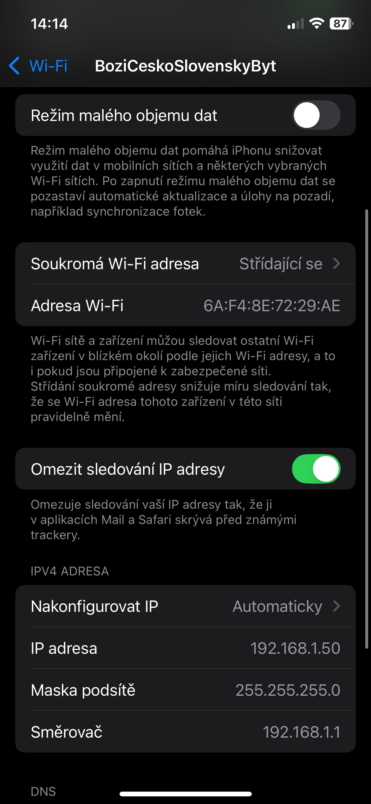
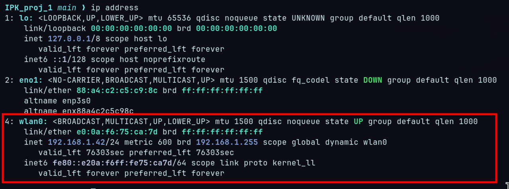
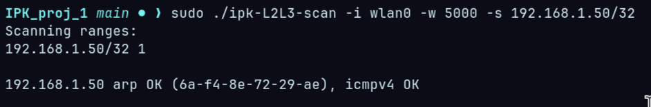
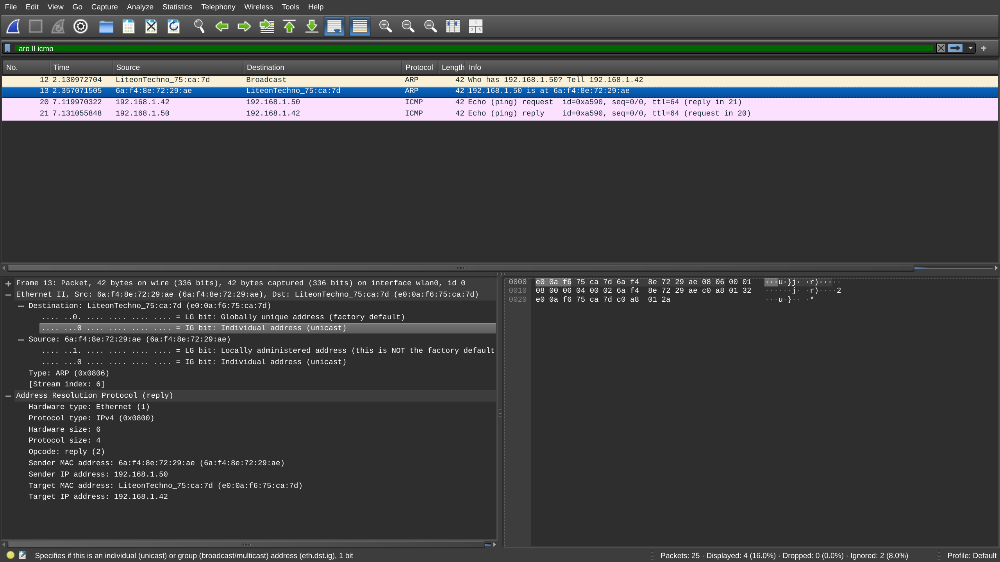
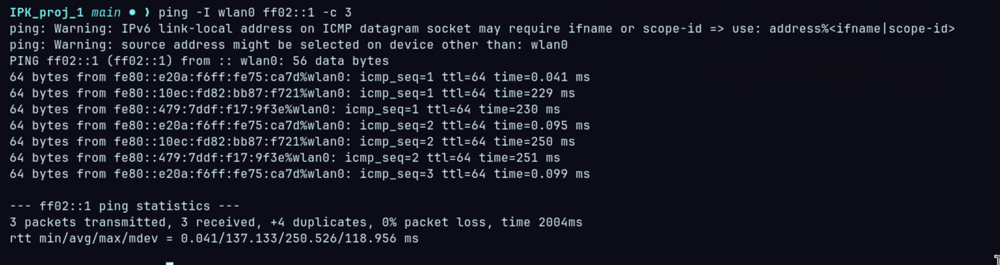
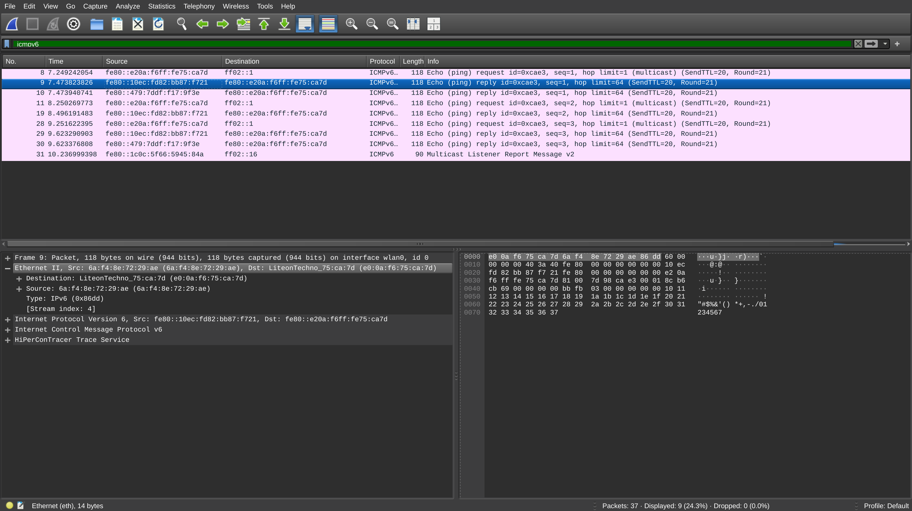
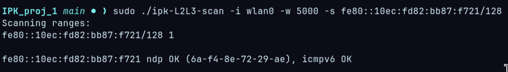
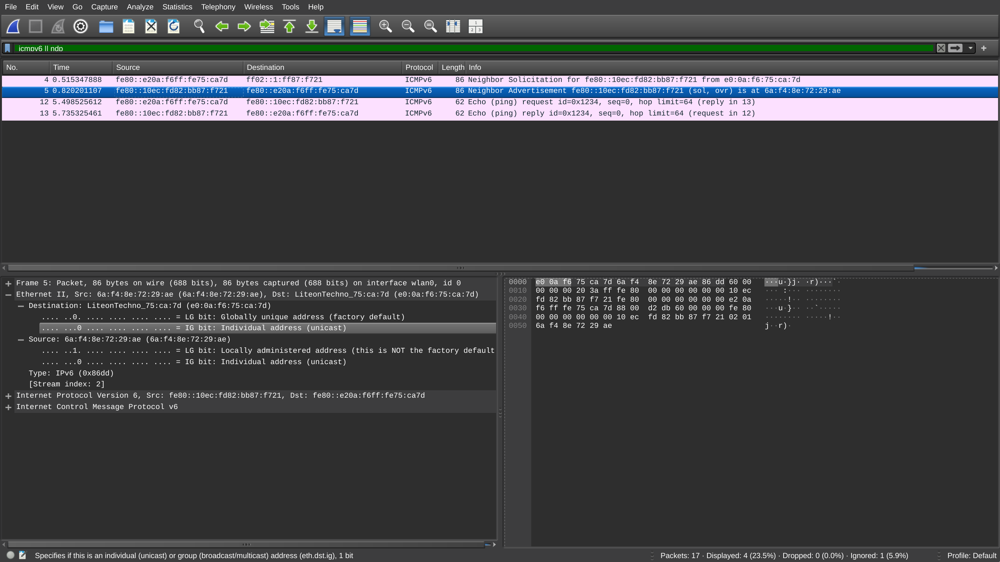

# IPK – L2/L3 Network Scanner (ARP/NDP + ICMP)

## Úvod
V tomto projektu jsem měl za úkol implementovat nástroj pro skenování dostupnosti síťových zařízení na druhé a třetí vrstvě modelu OSI. Program se zaměřuje na detekci aktivních hostů pomocí protokolů **ARP**, **ICMPv4**, **NDP** a **ICMPv6**.

Motivací implementace je hlubší pochopení nízkoúrovňové síťové komunikace a zachytávání paketů. Program vytváří vlastní pakety a analyzuje odpovědi za použití knihovny **libpcap**. Tento přístup poskytuje přesnou kontrolu nad obsahem paketů a umožňuje implementovat skenování nezávisle na systémových nástrojích.

---

## Kompilace a spuštění programu

Tato kapitola popisuje požadavky pro sestavení, návod k překladu a praktické příklady spuštění skeneru.

### Podporované platformy

Tento projekt je určen pro POSIX-kompatibilní systémy (Linux).
Využívá knihovnu libpcap a POSIX API, proto není určen pro nativní spuštění na Windows.

Uživatelé Windows mohou projekt spustit pomocí WSL.

### Požadavky
Pro úspěšné sestavení a spuštění projektu je potřeba mít v systému nainstalováno:

- GNU `gcc` (podpora C23 / `gnu23`)
- knihovnu `libpcap` (včetně hlaviček)
- Python 3 (pro spouštění testů)
- práva `root` (nebo spuštění přes `sudo`) pro práci s raw sockety a odchytávání paketů pomocí pcap

### Překlad
V kořenovém adresáři projektu je připravený `Makefile`. Kompilace proběhne příkazem:

```bash
make
```

Výsledný binární soubor:

- `ipk-L2L3-scan`

### Příprava balíku pro odevzdání (pokud je podporováno Makefilem)
Pokud tvůj `Makefile` obsahuje cíle `pack` a např. `xcernoj00.tar`, můžeš vytvořit archiv příkazem:

```bash
make pack
```

To typicky vytvoří tar archiv obsahující zdrojové soubory, `Makefile` a dokumentaci.

> Pozn.: Pokud tyto cíle v aktuální verzi `Makefile` nejsou, je potřeba je doplnit.

### Spuštění testů
Projekt obsahuje testovací skript `tests/test_all.py`. Testy je nutné spouštět s právy root (kvůli raw socketům a pcap):

```bash
sudo make test
```

`make test` zároveň připraví lokální Python virtualenv (např. `.venv`) a doinstaluje potřebné moduly (např. `pytest`), aby testy šly spustit i na „čistém“ systému.

---

## Použití programu

Program má jednoduchou nápovědu (funkce `print_usage`). Základní syntaxi a příklady uvádíme níže.

### Syntaxe

```text
./ipk-L2L3-scan -i INTERFACE [-s SUBNET]... [-w TIMEOUT]
./ipk-L2L3-scan -i
./ipk-L2L3-scan -h | --help
```

### Parametry
- `-i <interface>` – rozhraní pro sken (např. `eth0`, `enp0s3`).
  - Pokud je `-i` použito bez hodnoty, program vypíše aktivní rozhraní.
- `-s <subnet>` – cílová podsíť v CIDR zápisu (IPv4 nebo IPv6). Lze zadat vícekrát.
  - Příklad IPv4: `192.168.1.0/24`
  - Příklad IPv6: `2001:db8::/64`
- `-w <timeout>` – timeout pro jeden host v milisekundách (výchozí hodnota je 1000 ms).

### Příklady
Výpis aktivních rozhraní:

```bash
./ipk-L2L3-scan -i
```

Sken IPv4:

```bash
sudo ./ipk-L2L3-scan -i eth0 -s 192.168.1.0/24 -w 1000
```

Sken IPv6:

```bash
sudo ./ipk-L2L3-scan -i eth0 -s fd00:cafe:0000:face::0/126 -w 1000
```

---

## Analýza a návrh

Návrh řešení vychází z požadavku na skenování hostů na vrstvě L2 i L3. Pro IPv4 je využit **ARP** a **ICMP echo request**, zatímco pro IPv6 jsou použity **NDP Neighbor Solicitation** a **ICMPv6 echo request**.

Architektura programu je modulární. Každý protokol je implementován v samostatném modulu, který zajišťuje:

- sestavení paketu,
- odeslání rámce (typicky pomocí `pcap_inject`),
- zachycení odpovědi pomocí `pcap`,
- vyhodnocení výsledku.

---

## Popis jednotlivých protokolů

### ARP (IPv4, L2)
Protokol ARP (Address Resolution Protocol) slouží k překladu IPv4 adresy na MAC adresu v rámci lokální sítě. Princip spočívá v odeslání broadcast ARP requestu, který obsahuje cílovou IPv4 adresu. Všechna zařízení v síti rámec přijmou, avšak odpoví pouze zařízení, jehož IPv4 adresa odpovídá dotazu. Odpověď je zaslána unicastem a obsahuje MAC adresu cílového zařízení.

Tato vlastnost umožňuje spolehlivě detekovat aktivní hosty v lokální IPv4 síti.

### ICMPv4 (IPv4, L3)
ICMPv4 echo request/reply je využíván pro ověření dostupnosti hosta na třetí vrstvě. Program odešle ICMP echo request na cílovou IPv4 adresu. Pokud je host dostupný a neblokuje ICMP provoz, odpoví ICMP echo reply.

Výhodou ICMPv4 oproti ARP je možnost testovat i zařízení mimo lokální broadcast doménu, pokud je mezi nimi směrování.

### NDP (IPv6, L2)
V IPv6 sítích nahrazuje ARP protokol NDP (Neighbor Discovery Protocol). Pro zjištění MAC adresy je odeslán Neighbor Solicitation paket na tzv. **solicited-node multicast** adresu odvozenou z cílové IPv6 adresy. Tento multicast je doručen pouze relevantním uzlům, což snižuje zatížení sítě.

Cílový host odpoví paketem Neighbor Advertisement, který obsahuje jeho MAC adresu. Tím je možné detekovat existenci zařízení v lokální IPv6 síti.

### ICMPv6 (IPv6, L3)
ICMPv6 echo request funguje analogicky k IPv4 variantě. Program odešle ICMPv6 echo request na cílovou IPv6 adresu a čeká na echo reply. Tento mechanismus slouží k potvrzení dostupnosti hosta na síťové vrstvě.

Pro správnou funkci je nutné zahrnout IPv6 pseudo-hlavičku při výpočtu checksumu ICMPv6 paketu.

---

## Implementace (stručný popis)

Implementace využívá knihovnu **libpcap** pro práci se síťovými rámci. Pakety jsou sestavovány ručně jako posloupnost hlaviček (Ethernet + IP + příslušný protokol).

- **IPv4 ARP skenování**: vytvoří se broadcast Ethernet rámec obsahující ARP request. Odpovědi se zachytávají přes pcap a vyhodnocují podle obsahu ARP reply.
- **ICMPv4 skenování**: odešle se ICMP echo request (raw socket). Odpověď se kontroluje jako ICMP echo reply.
- **NDP skenování**: Neighbor Solicitation se posílá na solicited-node multicast; Neighbor Advertisement nese MAC cíle.
- **ICMPv6 skenování**: echo request se posílá v Ethernet rámci (pcap inject), checksum se počítá včetně IPv6 pseudo-hlavičky. Pro přesnější zachytávání odpovědí je použit BPF filtr.

Celý program je navržen s důrazem na:
- minimální závislost na systémových nástrojích,
- přesnou kontrolu nad obsahem paketů,
- modulární strukturu kódu,
- přehledné vyhodnocení výsledků.

---

## Architektura systému (moduly)
Orientačně:

- `src/args.*` – parsování CLI a nápověda
- `src/iface.*` – výpis rozhraní + získání MAC/IP rozhraní
- `src/subnet.*` – parsování CIDR a iterace přes hosty
- `src/arp.*` – ARP request + zpracování ARP reply
- `src/icmp.*` – ICMPv4 echo scan
- `src/ndp.*` – NDP Neighbor Solicitation/Advertisement
- `src/icmpv6.*` – ICMPv6 echo scan
- `src/compat.*` – sdílené utility (např. checksum)

---

## Testování a výsledky

### Python testy
Testy jsou implementované v Pythonu v souboru `tests/test_all.py` a spouští se přes:

```bash
sudo make test
```

Python testy ověřují správné chování CLI (help, neznámé parametry, kontrola povinných argumentů) a provádí jednoduchý sken na loopback rozhraní.

### Wireshark
Pomocí Wiresharku jsem manuálně ověřil skenování reálného zařízení (mobilního telefonu) v domácí Wi‑Fi síti.

#### IPv4 (ARP + ICMPv4)
Nejprve jsem v nastavení telefonu zjistil IPv4 adresu Wi‑Fi připojení:


Dále jsem spustil Wireshark a začal naslouchat na rozhraní `wlan0`. Aktivní rozhraní jsem ověřil pomocí příkazu `ip address`:


Ve Wiresharku jsem nastavil filtr na ARP a ICMPv4 pakety (např. `arp or icmp`) a spustil skener:


Výsledek skenu jsem porovnal s pozorováním ve Wiresharku a ověřil jsem, že IPv4 sken funguje správně:


Ve Wiresharku je vidět, že ARP vrátil stejnou MAC adresu, jakou reportuje cílové zařízení, a zároveň jsou vidět ICMP echo request/reply pakety.

#### IPv6 (NDP + ICMPv6)
IPv6 jsem testoval podobně. Nejprve bylo potřeba zjistit IPv6 adresu telefonu. Protože jsem ji nenašel přímo v nastavení zařízení, postupoval jsem přes Wireshark.

Nejdříve jsem (na lokální síti) poslal ICMPv6 echo request na all-nodes multicast a nechal si ve Wiresharku zobrazit odpovědi:


Ve Wiresharku jsem nastavil filtr na ICMPv6 a podle porovnání MAC adres jsem identifikoval IPv6 adresu telefonu:


Poté jsem ve Wiresharku filtroval ICMPv6 a NDP (např. `icmpv6 or ndp`) a spustil skener pro cílovou IPv6 adresu telefonu:


Nakonec jsem výsledky opět porovnal s pozorováním ve Wiresharku:


Tímto testováním jsem si ověřil, jak vypadají pakety ve Wiresharku, a že program správně realizuje NDP (zjištění MAC) a následný ICMPv6 echo scan.

## Poznámka k využití AI

Při tvorbě části testů a dokumentace byly pro pomocné účely využity nástroje založené na AI (návrhy textů a struktury dokumentace, doporučení pro testovací scénáře). Konkrétně byl použit model GPT-5.2 od Github Copilota. Finální obsah byl zkontrolován a upraven autorem projektu.

## Zdroje

[1] RFC 826: An Ethernet Address Resolution Protocol. [online]. Dostupné z: https://datatracker.ietf.org/doc/html/rfc826  

[2] RFC 792: Internet Control Message Protocol (ICMP). [online]. Dostupné z: https://datatracker.ietf.org/doc/html/rfc792  

[3] RFC 4443: Internet Control Message Protocol (ICMPv6). [online]. Dostupné z: https://datatracker.ietf.org/doc/html/rfc4443  

[4] RFC 4861: Neighbor Discovery for IP version 6 (NDP). [online]. Dostupné z: https://datatracker.ietf.org/doc/html/rfc4861  

[5] libpcap manual pages. [online]. Dostupné z: https://www.tcpdump.org/manpages/pcap.3pcap.html  

[6] pcap-filter manual. [online]. Dostupné z: https://www.tcpdump.org/manpages/pcap-filter.7.html  
